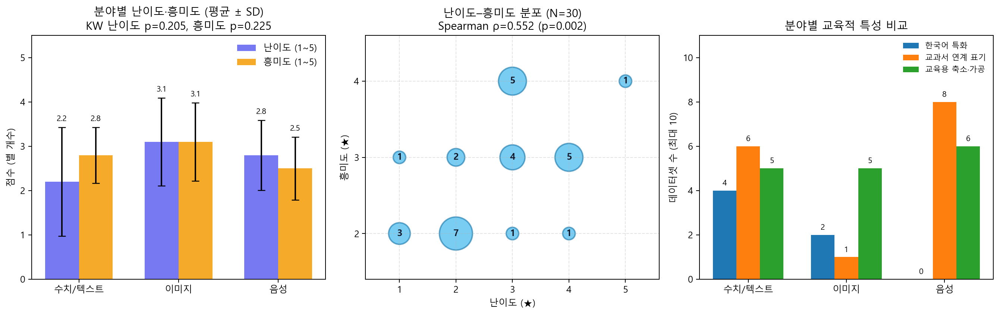
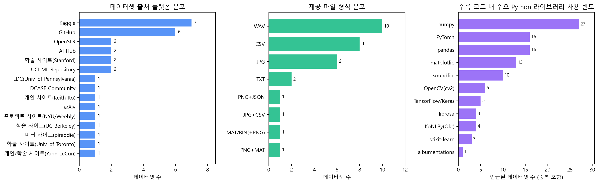
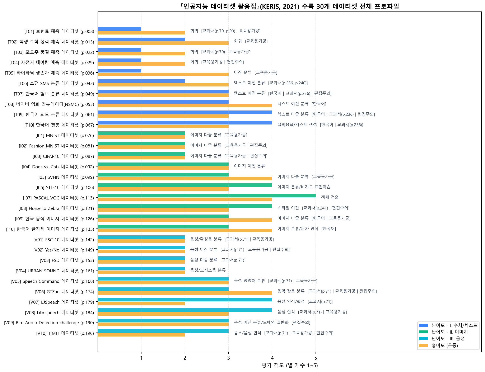

# AI 교육용 데이터셋 활용집 (KERIS 2021 정리본)

한국교육학술정보원(KERIS)에서 2021년 발간한 **『인공지능 데이터셋 활용집』** 에 수록된 **3개 대주제 × 10개 = 총 30개 AI 교육용 데이터셋**의 메타데이터, 목적, 검증된 공식 링크, 특성, 전처리·교육 활용 포인트 및 예시 파이썬 코드를 GitHub 저장소 형태로 체계화한 자료입니다.

> **원본 출처 및 라이선스**
> - 발행 기관: 한국교육학술정보원 (KERIS, 2021)
> - 저작권 안내: 공공누리 제4유형 (출처표시 · 상업적 이용금지 · 변경금지)
> - 본 저장소는 원본 PDF(105.4 MB, GitHub 100 MB 제한으로 저장소 미포함)의 내용을 교육·연구 목적으로 구조화·정리하였으며, **2026년 기준 30개 전체 대표 링크의 실제 접속 가능 여부(HTTP 200 OK / 브라우저 실측)** 를 검증하여 반영했습니다.

---

## 주요 특징 및 링크 검증 결과

1. **전수 링크 검증 (유지 28종 · 공식 미러 대체 2종 · 삭제 0종)**
   - **원본 유지 및 공식 리다이렉트 확인 (28종)**: UCI ML Repository 신규 경로(`/dataset/...`), AI Hub 신규 뷰어 경로, DCASE HTTPS 리다이렉트, GitHub, Stanford, OpenSLR, Kaggle 7종 등 모두 정상 접속(`200 OK`)을 확인했습니다.
   - **만료 링크 공식 미러 대체 (2종)**:
     - `II-01 MNIST`: 원문 `http://yann.lecun.com/exdb/mnist/`의 `.gz` 파일 다운로드가 `404`이므로, 공식 CVDF GCP 미러(`https://storage.googleapis.com/cvdf-datasets/mnist/`) 및 PyTorch/OSSCI S3 미러(`https://ossci-datasets.s3.amazonaws.com/mnist/`)로 대체했습니다 (`200 OK`).
     - `II-08 Horse to Zebra`: 원문 `https://people.eecs.berkeley.edu/~taesung_park/CycleGAN/datasets/`가 `404`이므로, 공식 CycleGAN 아카이브 서버(`http://efrosgans.eecs.berkeley.edu/cyclegan/datasets/`, `horse2zebra.zip`)로 대체했습니다 (`200 OK`).
   - **코드 내 단축·임시 다운로드 URL 보완**: 수록 코드 예시 중 `I-02`, `I-03`, `I-04`, `I-05`, `II-04`에 포함된 개인 Google Drive / KakaoCDN 링크는 `404`로 만료되어, 각 데이터셋 `README.md` 및 `prepare_dataset.py` 주석에 공식 출처 다운로드 방법을 함께 안내했습니다.
2. **예시 코드 분리 및 문법 검증 완료**
   - 30개 데이터셋 폴더마다 상세 해설 `README.md`와 함께 `prepare_dataset.py`를 분리 수록했으며, 30개 스크립트 모두 Python `py_compile` 문법 검사를 통과했습니다.
3. **정량 분석 및 원문 편집 오류 검수**
   - 전체 198페이지 OCR·육안 교차 검수 기반 카탈로그(`secondary_data/datasets_catalog.csv`), 통계 분석 보고서(`interim_reports/01_keris_ai_dataset_analysis.md`), 시각화 3종(`visualizations/*.png`)을 제공합니다.

---

## 저장소 구조

```text
AI_edu_dataset/
├── README.md                              # 전체 개요 및 30개 데이터셋 마스터 인덱스
├── .gitignore                             # 원본 대용량 PDF(>100MB), 임시 렌더링/OCR 캐시 제외
├── datasets/
│   ├── 01_tabular_and_text/               # Ⅰ. 수치/텍스트 데이터셋 (10종)
│   │   ├── README.md
│   │   ├── 01_insurance_cost/             # README.md + prepare_dataset.py
│   │   ├── ...
│   │   └── 10_korean_chatbot/
│   ├── 02_image/                          # Ⅱ. 이미지 데이터셋 (10종)
│   │   ├── README.md
│   │   ├── 01_mnist/                      # [공식 미러 대체]
│   │   ├── ...
│   │   └── 10_korean_font_image/
│   └── 03_audio/                          # Ⅲ. 음성 데이터셋 (10종)
│       ├── README.md
│       ├── 01_esc10/
│       ├── ...
│       └── 10_timit/
├── secondary_data/
│   └── datasets_catalog.csv               # 30개 데이터셋 정형 카탈로그 (UTF-8-SIG)
├── visualizations/
│   ├── 01_section_characteristics.png       # 분야별 난이도·흥미도·학습유형·한국어/교과서 연계 비율
│   ├── 02_platforms_formats_libraries.png   # 출처 플랫폼·파일 형식·주요 파이썬 라이브러리 분포
│   └── 03_all_30_datasets_profile.png       # 전체 30종 데이터셋 난이도/흥미도/페이지 프로파일
├── interim_reports/
│   └── 01_keris_ai_dataset_analysis.md    # 전수 분석·비모수 통계검정·링크 검증 보고서
└── scripts/                               # PDF 렌더링, OCR, 시각화, 생성 및 검증 파이프라인
```

---

## 데이터셋 목차 (3개 대주제 × 10종)

### [Ⅰ. 수치/텍스트 데이터셋 (Tabular & Text Datasets)](./datasets/01_tabular_and_text/README.md)

정형 수치 회귀·이진 분류 5종(`01`~`05`)과 자연어 처리 5종(`06`~`10`, 한국어 4종 포함)으로 구성되어 있습니다.

| 번호 | 데이터셋 명 (영문) | 카테고리 / 목적 | 난이도 | 흥미도 | 형태 | 검증된 공식 링크 | 문서 · 코드 |
|---|---|---|---|---|---|---|---|
| T01 | 보험료 예측 데이터셋 (Medical Cost Personal Datasets) | 수치 / 회귀분석 (`지도학습`) | ★☆☆☆☆ (1/5) | ★★☆☆☆ (2/5) | CSV | [Kaggle](https://www.kaggle.com/datasets/mirichoi0218/insurance) | [설명](./datasets/01_tabular_and_text/01_insurance_cost/README.md) · [코드](./datasets/01_tabular_and_text/01_insurance_cost/prepare_dataset.py) |
| T02 | 학생 수학 성적 예측 데이터셋 (Student Performance) | 수치 / 회귀분석 (`지도학습`) | ★★☆☆☆ (2/5) | ★★★☆☆ (3/5) | CSV | [UCI ML](https://archive.ics.uci.edu/dataset/320/student+performance) | [설명](./datasets/01_tabular_and_text/02_student_math_performance/README.md) · [코드](./datasets/01_tabular_and_text/02_student_math_performance/prepare_dataset.py) |
| T03 | 포도주 품질 예측 데이터셋 (Red Wine Quality) | 수치 / 회귀분석 (`지도학습`) | ★☆☆☆☆ (1/5) | ★★☆☆☆ (2/5) | CSV | [Kaggle](https://www.kaggle.com/datasets/uciml/red-wine-quality-cortez-et-al-2009) | [설명](./datasets/01_tabular_and_text/03_wine_quality/README.md) · [코드](./datasets/01_tabular_and_text/03_wine_quality/prepare_dataset.py) |
| T04 | 자전거 대여량 예측 데이터셋 (Bike Sharing Demand) | 수치 / 회귀분석 (`지도학습`) | ★☆☆☆☆ (1/5) | ★★☆☆☆ (2/5) | CSV | [Kaggle](https://www.kaggle.com/c/bike-sharing-demand) | [설명](./datasets/01_tabular_and_text/04_bike_sharing_demand/README.md) · [코드](./datasets/01_tabular_and_text/04_bike_sharing_demand/prepare_dataset.py) |
| T05 | 타이타닉 생존자 예측 데이터셋 (Titanic) | 수치 / 이진 분류 (`지도학습`) | ★☆☆☆☆ (1/5) | ★★★☆☆ (3/5) | CSV | [Kaggle](https://www.kaggle.com/c/titanic) | [설명](./datasets/01_tabular_and_text/05_titanic_survival/README.md) · [코드](./datasets/01_tabular_and_text/05_titanic_survival/prepare_dataset.py) |
| T06 | 스팸 SMS 분류 데이터셋 (SMS Spam Collection) | 텍스트 / 이진 분류 (`지도학습`) | ★★☆☆☆ (2/5) | ★★★☆☆ (3/5) | CSV | [UCI ML](https://archive.ics.uci.edu/dataset/228/sms+spam+collection) | [설명](./datasets/01_tabular_and_text/06_spam_sms/README.md) · [코드](./datasets/01_tabular_and_text/06_spam_sms/prepare_dataset.py) |
| T07 | 한국어 혐오 분류 데이터셋 (Womad Hate Speech) | 한국어 텍스트 / 이진 분류 (`지도학습`) | ★★★☆☆ (3/5) | ★★★☆☆ (3/5) | CSV | [Kaggle](https://www.kaggle.com/datasets/captainnemo9292/korean-extremist-website-womad-hate-speech-data) | [설명](./datasets/01_tabular_and_text/07_korean_hate_speech/README.md) · [코드](./datasets/01_tabular_and_text/07_korean_hate_speech/prepare_dataset.py) |
| T08 | 네이버 영화 리뷰데이터 (NSMC) | 한국어 텍스트 / 감성 이진 분류 (`지도학습`) | ★★★☆☆ (3/5) | ★★★★☆ (4/5) | TXT | [GitHub](https://github.com/e9t/nsmc) | [설명](./datasets/01_tabular_and_text/08_naver_movie_review_nsmc/README.md) · [코드](./datasets/01_tabular_and_text/08_naver_movie_review_nsmc/prepare_dataset.py) |
| T09 | 한국어 의도 분류 데이터셋 (3i4k) | 한국어 텍스트 / 7클래스 다중 분류 (`지도학습`) | ★★★★☆ (4/5) | ★★★☆☆ (3/5) | TXT | [GitHub](https://github.com/warnikchow/3i4k) | [설명](./datasets/01_tabular_and_text/09_korean_intent_3i4k/README.md) · [코드](./datasets/01_tabular_and_text/09_korean_intent_3i4k/prepare_dataset.py) |
| T10 | 한국어 챗봇 데이터셋 (Chatbot_data) | 한국어 텍스트 / 질의응답·생성 (`지도학습`) | ★★★★☆ (4/5) | ★★★☆☆ (3/5) | CSV | [GitHub](https://github.com/songys/Chatbot_data) | [설명](./datasets/01_tabular_and_text/10_korean_chatbot/README.md) · [코드](./datasets/01_tabular_and_text/10_korean_chatbot/prepare_dataset.py) |

---

### [Ⅱ. 이미지 데이터셋 (Image Datasets)](./datasets/02_image/README.md)

이미지 분류 7종, 객체 검출 1종(PASCAL VOC), 비지도 스타일 이전 1종(Horse to Zebra), OCR 1종(한국어 글자체)으로 구성되어 있습니다.
(`02 Fashion MNIST`와 `03 CIFAR10`은 본문 수록 순서인 p.081, p.087 기준으로 배열했습니다.)

| 번호 | 데이터셋 명 (영문) | 카테고리 / 목적 | 난이도 | 흥미도 | 형태 | 검증된 공식 링크 | 문서 · 코드 |
|---|---|---|---|---|---|---|---|
| I01 | MNIST 데이터셋 (MNIST Datasets) | 이미지 / 10클래스 분류 (`지도학습`) | ★★☆☆☆ (2/5) | ★★☆☆☆ (2/5) | JPG | [CVDF 공식 미러 (대체)](https://storage.googleapis.com/cvdf-datasets/mnist/) | [설명](./datasets/02_image/01_mnist/README.md) · [코드](./datasets/02_image/01_mnist/prepare_dataset.py) |
| I02 | Fashion MNIST 데이터셋 | 이미지 / 10클래스 분류 (`지도학습`) | ★★☆☆☆ (2/5) | ★★☆☆☆ (2/5) | JPG | [GitHub](https://github.com/zalandoresearch/fashion-mnist) | [설명](./datasets/02_image/02_fashion_mnist/README.md) · [코드](./datasets/02_image/02_fashion_mnist/prepare_dataset.py) |
| I03 | CIFAR10 데이터셋 | 이미지 / 10클래스 분류 (`지도학습`) | ★★☆☆☆ (2/5) | ★★☆☆☆ (2/5) | JPG | [Univ. of Toronto](https://www.cs.toronto.edu/~kriz/cifar.html) | [설명](./datasets/02_image/03_cifar10/README.md) · [코드](./datasets/02_image/03_cifar10/prepare_dataset.py) |
| I04 | Dogs vs. Cats 데이터셋 | 이미지 / 이진 분류 (`지도학습`) | ★★★☆☆ (3/5) | ★★★☆☆ (3/5) | JPG | [Kaggle](https://www.kaggle.com/c/dogs-vs-cats/overview) | [설명](./datasets/02_image/04_dogs_vs_cats/README.md) · [코드](./datasets/02_image/04_dogs_vs_cats/prepare_dataset.py) |
| I05 | SVHN 데이터셋 (Street View House Numbers) | 이미지 / 10클래스 분류 (`지도학습`) | ★★★☆☆ (3/5) | ★★★★☆ (4/5) | PNG+MAT | [Stanford](http://ufldl.stanford.edu/housenumbers/) | [설명](./datasets/02_image/05_svhn/README.md) · [코드](./datasets/02_image/05_svhn/prepare_dataset.py) |
| I06 | STL-10 데이터셋 | 이미지 / 분류 및 비지도 표현 학습 (`지도+비지도`) | ★★★★☆ (4/5) | ★★★☆☆ (3/5) | MAT/BIN(+PNG) | [Stanford](https://cs.stanford.edu/~acoates/stl10/) | [설명](./datasets/02_image/06_stl10/README.md) · [코드](./datasets/02_image/06_stl10/prepare_dataset.py) |
| I07 | PASCAL VOC 데이터셋 | 이미지 / 객체 검출 (`지도학습`) | ★★★★★ (5/5) | ★★★★☆ (4/5) | JPG(+XML) | [pjreddie Mirror](https://pjreddie.com/projects/pascal-voc-dataset-mirror/) | [설명](./datasets/02_image/07_pascal_voc/README.md) · [코드](./datasets/02_image/07_pascal_voc/prepare_dataset.py) |
| I08 | Horse to Zebra 데이터셋 | 이미지 / 스타일 이전 (`비지도학습`) | ★★★★☆ (4/5) | ★★★☆☆ (3/5) | JPG+CSV | [Berkeley CycleGAN (대체)](http://efrosgans.eecs.berkeley.edu/cyclegan/datasets/) | [설명](./datasets/02_image/08_horse_to_zebra/README.md) · [코드](./datasets/02_image/08_horse_to_zebra/prepare_dataset.py) |
| I09 | 한국 음식 이미지 데이터셋 (Korean Food) | 한국 특화 이미지 / 다중 분류 (`지도학습`) | ★★★☆☆ (3/5) | ★★★★☆ (4/5) | JPG | [AI Hub](https://aihub.or.kr/aihubdata/data/view.do?currMenu=115&topMenu=100&aihubDataSe=data&dataSetSn=79) | [설명](./datasets/02_image/09_korean_food_image/README.md) · [코드](./datasets/02_image/09_korean_food_image/prepare_dataset.py) |
| I10 | 한국어 글자체 이미지 데이터셋 (Korean Font) | 한국어 이미지 / 분류·OCR (`지도학습`) | ★★★☆☆ (3/5) | ★★★★☆ (4/5) | PNG+JSON | [AI Hub](https://aihub.or.kr/aihubdata/data/view.do?currMenu=115&topMenu=100&aihubDataSe=data&dataSetSn=81) | [설명](./datasets/02_image/10_korean_font_image/README.md) · [코드](./datasets/02_image/10_korean_font_image/prepare_dataset.py) |

---

### [Ⅲ. 음성 데이터셋 (Audio Datasets)](./datasets/03_audio/README.md)

환경음·소음·명령어·장르 분류 6종, 연속 음성인식·합성(ASR/TTS) 3종, 도메인 일반화(새소리 검출) 1종으로 구성되어 있습니다.

| 번호 | 데이터셋 명 (영문) | 카테고리 / 목적 | 난이도 | 흥미도 | 형태 | 검증된 공식 링크 | 문서 · 코드 |
|---|---|---|---|---|---|---|---|
| V01 | ESC-10 데이터셋 (Environmental Sound Classification) | 음성 / 10클래스 환경음 분류 (`지도학습`) | ★★☆☆☆ (2/5) | ★★☆☆☆ (2/5) | WAV | [GitHub](https://github.com/karolpiczak/ESC-50) | [설명](./datasets/03_audio/01_esc10/README.md) · [코드](./datasets/03_audio/01_esc10/prepare_dataset.py) |
| V02 | Yes/No 데이터셋 | 음성 / 이진 분류 (`지도학습`) | ★★☆☆☆ (2/5) | ★★☆☆☆ (2/5) | WAV | [OpenSLR](https://www.openslr.org/1/) | [설명](./datasets/03_audio/02_yesno/README.md) · [코드](./datasets/03_audio/02_yesno/prepare_dataset.py) |
| V03 | FSD 데이터셋 (Free Spoken Digit) | 음성 / 0~9 숫자 음성 분류 (`지도학습`) | ★★☆☆☆ (2/5) | ★★☆☆☆ (2/5) | WAV | [GitHub](https://github.com/Jakobovski/free-spoken-digit-dataset) | [설명](./datasets/03_audio/03_free_spoken_digit/README.md) · [코드](./datasets/03_audio/03_free_spoken_digit/prepare_dataset.py) |
| V04 | URBAN SOUND 데이터셋 (UrbanSound8K) | 음성 / 10클래스 도시소음 분류 (`지도학습`) | ★★☆☆☆ (2/5) | ★★☆☆☆ (2/5) | WAV | [NYU/Weebly](https://urbansounddataset.weebly.com/urbansound8k.html) | [설명](./datasets/03_audio/04_urbansound8k/README.md) · [코드](./datasets/03_audio/04_urbansound8k/prepare_dataset.py) |
| V05 | Speech Command 데이터셋 | 음성 / 키워드 음성 명령어 분류 (`지도학습`) | ★★★☆☆ (3/5) | ★★★☆☆ (3/5) | WAV | [arXiv](https://arxiv.org/abs/1804.03209) | [설명](./datasets/03_audio/05_speech_commands/README.md) · [코드](./datasets/03_audio/05_speech_commands/prepare_dataset.py) |
| V06 | GTZan 데이터셋 | 음성 / 10장르 음악 분류 (`지도학습`) | ★★★☆☆ (3/5) | ★★★★☆ (4/5) | WAV | [Kaggle](https://www.kaggle.com/datasets/andradaolteanu/gtzan-dataset-music-genre-classification) | [설명](./datasets/03_audio/06_gtzan/README.md) · [코드](./datasets/03_audio/06_gtzan/prepare_dataset.py) |
| V07 | LJSpeech 데이터셋 | 음성 / 단일 화자 음성 인식·합성 (`지도학습`) | ★★★★☆ (4/5) | ★★☆☆☆ (2/5) | WAV+TXT | [Keith Ito](https://keithito.com/LJ-Speech-Dataset/) | [설명](./datasets/03_audio/07_ljspeech/README.md) · [코드](./datasets/03_audio/07_ljspeech/prepare_dataset.py) |
| V08 | Librispeech 데이터셋 | 음성 / 다중 화자 음성 인식 (`지도학습`) | ★★★★☆ (4/5) | ★★★☆☆ (3/5) | WAV(←FLAC) | [OpenSLR](http://www.openslr.org/11/) | [설명](./datasets/03_audio/08_librispeech/README.md) · [코드](./datasets/03_audio/08_librispeech/prepare_dataset.py) |
| V09 | Bird Audio Detection challenge | 음성 / 이진 분류·도메인 일반화 (`지도학습`) | ★★★☆☆ (3/5) | ★★★☆☆ (3/5) | WAV+CSV | [DCASE](https://dcase.community/challenge2018/task-bird-audio-detection) | [설명](./datasets/03_audio/09_bird_audio_detection/README.md) · [코드](./datasets/03_audio/09_bird_audio_detection/prepare_dataset.py) |
| V10 | TIMIT 데이터셋 | 음성 / 음소·연속 음성 인식 (`지도학습`) | ★★★☆☆ (3/5) | ★★☆☆☆ (2/5) | WAV+TXT | [LDC](https://catalog.ldc.upenn.edu/LDC93S1) | [설명](./datasets/03_audio/10_timit/README.md) · [코드](./datasets/03_audio/10_timit/prepare_dataset.py) |

---

## 정량 분석 요약 및 시각화

자세한 통계 검정(Kruskal-Wallis H, Spearman 순위상관)과 원문 검수 내용은 [중간 분석 보고서](./interim_reports/01_keris_ai_dataset_analysis.md)와 [데이터셋 카탈로그 CSV](./secondary_data/datasets_catalog.csv)에서 확인할 수 있습니다.

- **전체 난이도·흥미도**: 전체 30종 평균 난이도 `2.70 ± 1.06`(중앙값 3.0), 평균 흥미도 `2.80 ± 0.76`(중앙값 3.0).
- **분야 간 차이**: Kruskal-Wallis 검정 결과 분야 간 난이도(`H=3.1667, p=0.2053`) 및 흥미도(`H=2.9806, p=0.2253`)의 유의한 차이는 관찰되지 않았으나, 전체 데이터셋에서 난이도와 흥미도 간 유의한 양의 상관관계(`ρ = 0.5524, p = 0.0015`)가 나타납니다.
- **교육적 특성**: 지도학습 28종(93.3%), 교육용 경량 가공 16종(53.3%), 한국어 특화 6종(텍스트 4, 이미지 2, 음성 0), 교과서(`인공지능과 미래사회`) 연계 15종(50.0%).





---

## 원문(PDF) 정오표 참고사항

원본 PDF의 시각적 전수 검수 과정에서 발견된 편집 오타·불일치 사항을 각 데이터셋 문서에 주석으로 병기했습니다.

- **목차–본문 순서 불일치**: p.2 목차에는 `CIFAR10 (081)` → `Fashion MNIST (087)`로 표기되어 있으나, 실제 본문은 `02 Fashion MNIST (p.081)` → `03 CIFAR10 (p.087)` 순으로 수록됨.
- **복붙·라벨 오타**: `T04`(p.029 속성 수 9 vs 12 혼재), `T07`(p.049 `데이터셋 목적` 라벨 중복), `T09`(p.061 `2,000개 문장` 오기 — 실제 55,134문장), `I03`(p.089 그림 캡션 `Fashion MNIST`), `I08`(목차명 `Zebra2Horse`, p.122 `Pascal VOC 20클래스` 복붙 잔재), `V02`(p.150 `ESC-10` 복붙 잔재), `V06`(p.175 `Speech Command` 복붙 잔재), `V09`(p.190 `데이터셋 데이터셋` 중복), `V10`(p.196 `이진분류/도메인 일반화` 복붙 잔재).
- **원문 코드 주의점**: 일부 원문 스니펫(예: `T01`의 미정의 변수 `df`, Windows `CP949` 저장, 만료된 개인 Google Drive/KakaoCDN 링크 등)은 원문 보존과 함께 각 `prepare_dataset.py` 주석으로 해결 방법을 안내했습니다.
