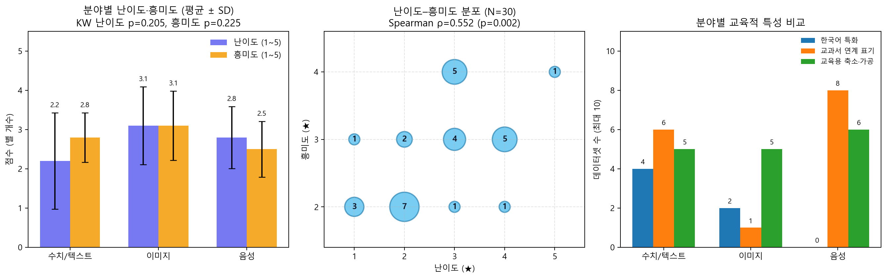
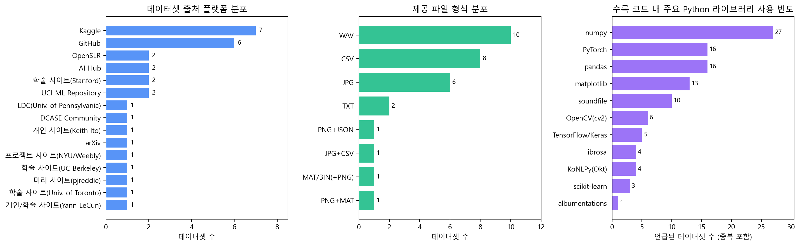
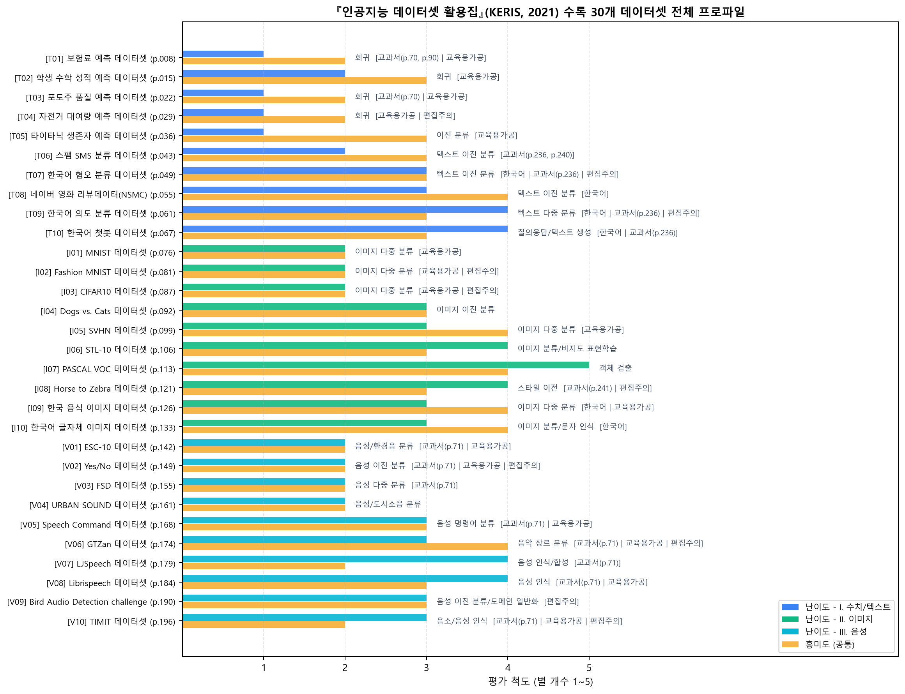

# 중간 보고서 01: 『인공지능 데이터셋 활용집』(KERIS, 2021) 전수 분석

## 1. 분석 대상 및 맥락
- **대상 파일**: [인공지능 데이터셋 활용집(2021,keris).pdf](file:///c:/Users/ysj/Desktop/upload_all/AI_edu_dataset/인공지능%20데이터셋%20활용집(2021,keris).pdf) (105,439,916 bytes, 총 198 PDF 페이지)
- **문서 메타데이터**: Adobe InDesign 16.4 (Windows) 제작, 원문 내 문서 제목 `"AI교육을 위한 데이터셋 분석자료집_내지편집 - 최신버전.indd"`, 생성일 2021-10-12.
- **발행 기관 및 라이선스**: 한국교육학술정보원(KERIS), 공공누리 제4유형(출처표시·상업적 이용금지·변경금지).
- **기술적 특성**: 전체 198페이지 모두 임베디드 텍스트 레이어가 없는 윤곽선/이미지 기반 PDF(`total_chars = 0`, `total_images = 1,068`, `toc_count = 0`).

## 2. 분석 방법론 및 재현 파이프라인
1. **PDF 구조 검사 및 페이지 렌더링**: [01_inspect_pdf.py](file:///c:/Users/ysj/Desktop/upload_all/AI_edu_dataset/scripts/01_inspect_pdf.py), [03_render_all_pages.py](file:///c:/Users/ysj/Desktop/upload_all/AI_edu_dataset/scripts/03_render_all_pages.py)를 이용해 전체 198페이지를 200 DPI PNG로 렌더링 (`책 쪽수 = PDF 페이지 + 3`, 책 p.008~201 수록).
2. **전체 페이지 OCR 추출**: [04_batch_winocr.ps1](file:///c:/Users/ysj/Desktop/upload_all/AI_edu_dataset/scripts/04_batch_winocr.ps1) (Windows 내장 `ko` OCR 엔진)로 198페이지 전체 텍스트 추출 (`intermediate_results/ocr_all_pages.json`).
3. **시각적 교차 검증**: 30개 데이터셋의 시작 2페이지(총 60페이지)를 15개 2x2 몽타주([05_build_dataset_montages.py](file:///c:/Users/ysj/Desktop/upload_all/AI_edu_dataset/scripts/05_build_dataset_montages.py))로 결합해 난이도/흥미도 별점, URL, 파일 형식, 클래스/속성 수를 직접 육안 검증. 또한 여백 크롭 스크립트([09_verify_all_textbook_margins.py](file:///c:/Users/ysj/Desktop/upload_all/AI_edu_dataset/scripts/09_verify_all_textbook_margins.py), [09_check_odd_margins.py](file:///c:/Users/ysj/Desktop/upload_all/AI_edu_dataset/scripts/09_check_odd_margins.py))로 교과서 연계 쪽수(`인공지능과 미래사회`)를 전수 검증.
4. **정량·통계 분석 및 시각화**: [11_build_catalog_and_analyze.py](file:///c:/Users/ysj/Desktop/upload_all/AI_edu_dataset/scripts/11_build_catalog_and_analyze.py)로 구조화 카탈로그([datasets_catalog.csv](file:///c:/Users/ysj/Desktop/upload_all/AI_edu_dataset/secondary_data/datasets_catalog.csv)) 생성, 비모수 가설검정(Kruskal-Wallis H, Spearman 순위상관) 및 시각화 수행.

## 3. 주요 분석 결과

### 3.1. 전체 구성 및 모달리티별 분포
총 30개 데이터셋이 3개 대단원(각 10종)으로 균등 편성되어 있음:
- **I. 수치/텍스트 데이터셋** (p.008~073, 66p): 정형 수치 회귀/분류 5종(T01~T05) + 자연어 처리 5종(T06~T10).
- **II. 이미지 데이터셋** (p.076~139, 64p): 분류 7종, 객체 검출 1종(PASCAL VOC), 스타일 이전 1종(Horse to Zebra), OCR 1종(한국어 글자체).
- **III. 음성 데이터셋** (p.142~201, 60p): 환경음/소음/명령어/장르 분류 6종, 연속 음성인식(ASR)·합성 3종(LJSpeech, Librispeech, TIMIT), 도메인 일반화 1종(Bird Audio Detection).

### 3.2. 난이도·흥미도 통계 및 가설검정
- **가정 및 방법 선택**: 난이도와 흥미도는 1~5점 순서척도(별 개수)이며 분야별 표본 크기가 $n=10$으로 소표본이므로, 정규성 가정을 요하는 모수 ANOVA 대신 비모수 **Kruskal-Wallis H 검정**과 **Spearman 순위상관**을 사용함.
- **기술통계** (전체 $N=30$): 난이도 평균 $2.70 \pm 1.06$ (중앙값 3.0), 흥미도 평균 $2.80 \pm 0.76$ (중앙값 3.0).
  - 수치/텍스트: 난이도 $2.20 \pm 1.23$ (중앙값 2.0, IQR 2.0), 흥미도 $2.80 \pm 0.63$ (중앙값 3.0, IQR 0.75)
  - 이미지: 난이도 $3.10 \pm 0.99$ (중앙값 3.0, IQR 1.5), 흥미도 $3.10 \pm 0.88$ (중앙값 3.0, IQR 1.75)
  - 음성: 난이도 $2.80 \pm 0.79$ (중앙값 3.0, IQR 1.0), 흥미도 $2.50 \pm 0.71$ (중앙값 2.0, IQR 1.0)
- **분야 간 차이 검정**: 난이도($H=3.1667, p=0.2053$)와 흥미도($H=2.9806, p=0.2253$) 모두 유의수준 $\alpha=0.05$에서 분야 간 통계적으로 유의한 차이가 관찰되지 않음 (소표본 $n=10$의 검정력 한계 존재).
- **난이도–흥미도 상관관계**: 전체 30개 데이터셋에서 난이도와 흥미도는 유의한 양의 상관관계를 보임 ($\rho = 0.5524, p = 0.0015$). 즉, 실전형·심화 태스크(NSMC, SVHN, PASCAL VOC, 한국 음식/글자체 등)일수록 흥미도 평가가 높음.

### 3.3. 출처, 파일 형식, 코드 생태계 및 교육적 가공

- **출처 플랫폼**: Kaggle(7종, 23.3%), GitHub(6종, 20.0%), 대학·학술 사이트(Stanford, Toronto, UC Berkeley, LDC 등 6종), UCI ML Repository(2종), OpenSLR(2종), 국내 **AI Hub(2종)** 등.
- **학습 패러다임**: 지도학습 28종(93.3%), 지도+비지도학습 1종(STL-10), 비지도학습 1종(Horse to Zebra).
- **수록 코드의 역할 및 프레임워크**: 수록된 `데이터셋 코드`는 AI 모델 학습 코드가 아니라 **원본 공개 데이터를 내려받아 교육 현장에 맞게 경량화·전처리·포맷 통일(CSV 한글화, 이미지 jpg 폴더 추출 및 클래스당 500/100장 제한, 음성 스펙트로그램 PNG 변환 등)하는 데이터 준비 스크립트**임.
  - 주요 라이브러리(OCR 검출 기준): `numpy`(27종), `pandas`(16종), `PyTorch`(16종), `matplotlib`(13종), `soundfile`(10종), `OpenCV(cv2)`(6종), `TensorFlow/Keras`(5종), `KoNLPy(Okt)`(4종), `librosa`(4종), `scikit-learn`(3종), `albumentations`(1종).
  - I. 수치/텍스트(1~5)는 `pandas`/`numpy`, 자연어(6~10)는 `KoNLPy`+`Keras`/`PyTorch`, II. 이미지(1~3)는 `TensorFlow/Keras`+`cv2`, 이미지(4~10) 및 III. 음성(1~10)은 `PyTorch`(`torchvision`, `torchaudio`)+`librosa`/`soundfile` 중심으로 구성됨.
- **교육적 가공 및 교과서 연계**:
  - 30종 중 **16종(53.3%)**은 속성 축소, 화폐 단위 변환(달러→원화), 클래스당 샘플 수 제한 등 교육용으로 경량 가공되어 있음.
  - **한국어 특화 데이터셋**은 총 **6종(20.0%)**: 텍스트 4종(한국어 혐오, NSMC, 한국어 의도, 한국어 챗봇), 이미지 2종(한국 음식, 한국어 글자체), **음성 0종**.
  - **교과서(`인공지능과 미래사회`) 연계 표기**: 총 **15종(50.0%)**에 쪽수가 병기됨 (`p.70`, `p.71`, `p.90`, `p.236`, `p.240`, `p.241`). 특히 음성(8/10종)은 `p.71`(스펙트로그램 전처리), 한국어 텍스트(4/5종)는 `p.236`에 집중 연계됨.

## 4. 문서 편집 품질 및 활용 시 주의사항 (직접 검수 결과)
1. **목차–본문 순서 불일치**: p.2 목차에는 `2) CIFAR10 _ 081`, `3) Fashion MNIST _ 087`로 기재되어 있으나, 실제 본문은 `02 Fashion MNIST (p.081)`가 먼저 나오고 `03 CIFAR10 (p.087)`이 뒤에 수록됨.
2. **복사-붙여넣기 잔재 및 라벨 오타**:
   - `T04 자전거 대여량(p.029)`: 도입문에 "총 9가지 속성"과 "12가지 속성" 혼재.
   - `T07 한국어 혐오(p.049)`: `데이터셋 목적` 라벨이 2회 중복 인쇄(두 번째는 특징 내용).
   - `T09 한국어 의도(p.061)`: 도입문에 "전체 2,000개의 문장" 오기(실제는 55,134문장).
   - `I08 Horse to Zebra(p.121~122)`: 목차명 `Zebra2Horse`와 본문 제목 불일치, `데이터셋 구성` 상단에 "Pascal VOC 데이터셋은 총 20개의 클래스" 잔재 문구 존재.
   - `V02 Yes/No(p.150)`: `데이터셋 구성` 상단에 "ESC-10 데이터셋은 총 10개의 클래스" 잔재 문구 존재.
   - `V06 GTZan(p.175)`: `원 데이터` 설명이 "Speech Command 데이터셋의 경우..."로 잘못 기재됨.
   - `V09 Bird(p.190)`: 제목 `"데이터셋 데이터셋"` 중복 표기.
   - `V10 TIMIT(p.196)`: 두 번째 `데이터셋 목적` 라벨에 V09의 `"이진분류 / 도메인 일반화"`가 복붙되어 있음.
3. **코드 실행 시 주의점**: 예컨대 `T01`(p.012) 코드에 미정의 변수 `df` 참조(`insurance['sex'][df['sex'] == 'male']`), MATLAB 스타일 주석(`%%`), `CP949` 저장 등 일부 문법/실행 오류가 존재하며, 2021년 기준 외부 링크(예: `yann.lecun.com`, UCI 구 URL 등)는 현재 접속 경로가 변경되었을 가능성이 있어 실행 전 URL 유효성 점검이 필요함.

## 5. 2026년 링크 전수 검증 및 GitHub 저장소 구축 결과
- **30개 대표 URL 전수 검증 결과 (유지 28종, 공식 미러 대체 2종, 삭제 0종)**:
  - `T01`~`T10`, `I02`~`I07`, `I09`~`I10`, `V01`~`V10` (총 28종): 원본 URL 또는 공식 리다이렉트(UCI 신규 경로 `/dataset/...`, AI Hub 신규 경로, DCASE HTTPS 등)로 `200 OK` 정상 접속 확인(`T07` Kaggle 페이지는 브라우저 서브에이전트로 실제 접근 및 `hate_speech_data.csv` 166.11 kB 확인).
  - **`I01 MNIST` 대체**: 원문 `http://yann.lecun.com/exdb/mnist/`의 `.gz` 파일 다운로드가 404이므로, 공식 CVDF GCP 미러(`https://storage.googleapis.com/cvdf-datasets/mnist/`) 및 PyTorch/OSSCI S3 미러(`https://ossci-datasets.s3.amazonaws.com/mnist/`)로 대체(`200 OK`).
  - **`I08 Horse to Zebra` 대체**: 원문 `https://people.eecs.berkeley.edu/~taesung_park/CycleGAN/datasets/`가 404이므로, 공식 CycleGAN 아카이브 서버(`http://efrosgans.eecs.berkeley.edu/cyclegan/datasets/`, `horse2zebra.zip`)로 대체(`200 OK`).
  - **코드 내 단축/임시 다운로드 URL 점검**: `T01`(GitHub raw), `T06`(GitHub raw), `V01`(ESC-50 `master.zip`), `V10`(`deepai.org` `timit.zip`)은 `200 OK` 확인. 반면 `T02`, `T03`, `T04`, `T05`, `I04`의 코드 예시에 포함된 개인 Google Drive·KakaoCDN 링크는 `404` 만료 상태이므로, 각 `README.md`와 `prepare_dataset.py` 주석에 공식 출처 다운로드 안내를 병기함.
- **저장소 구조화 및 검증**:
  - `datasets/01_tabular_and_text`, `datasets/02_image`, `datasets/03_audio` 하위 30개 데이터셋 폴더(`README.md` + `prepare_dataset.py`) 및 대주제별 `README.md` 생성 완료.
  - [20_validate_and_sync_catalog.py](file:///c:/Users/ysj/Desktop/upload_all/AI_edu_dataset/scripts/20_validate_and_sync_catalog.py) 실행을 통해 30개 `prepare_dataset.py` 문법 검사(`py_compile`) 통과 및 [datasets_catalog.csv](file:///c:/Users/ysj/Desktop/upload_all/AI_edu_dataset/secondary_data/datasets_catalog.csv)의 `verified_url`, `url_status_2026` 컬럼 동기화 완료.
  - 100 MB 초과 원본 PDF(105.4 MB)와 대용량 중간 산출물(`intermediate_results/`)은 `.gitignore`로 제외함.
